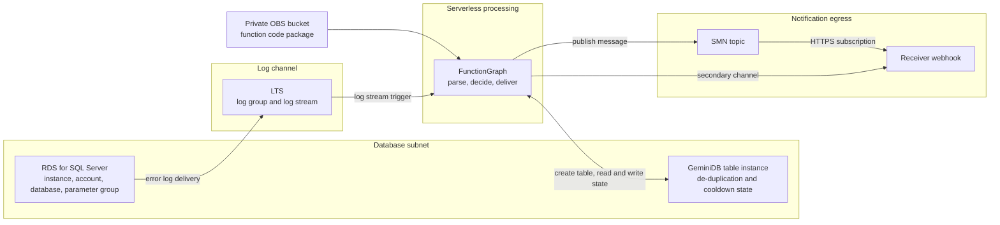

# Proactive Monitoring for RDS for SQL Server Error Logs

[](LICENSE)
[](https://www.huaweicloud.com)

## Overview

This sample builds an end-to-end pipeline on Huawei Cloud that turns SQL Server error logs into
proactive alerts: error log collection, server-side parsing and rule matching, de-duplication with a
notification cooldown window, message delivery, and observability.

Databases rarely fail quietly, but the failure signal is usually buried in an error log that nobody
reads until an incident is reported. Threshold-based alert rules do not fix this: they either miss
errors that have no metric, or fire repeatedly for the same error. This practice replaces threshold
rules with a serverless function and addresses three concrete problems:

1. **Complete collection.** The error log of the RDS for SQL Server instance is delivered to a
   Cloud Log Transfer Service (LTS) log stream, and every new batch of log lines triggers processing.
2. **Only real errors are reported.** Log lines are parsed into `error number + level + state`
   using the two formats that SQL Server actually writes, and a built-in list of informational
   phrases (log rotation, routine check output, notice-only messages) is skipped as noise.
3. **Duplicates converge.** Occurrences and alert timestamps are persisted in a GeminiDB table
   instance, so repeats inside the cooldown window are suppressed. When the state store cannot be
   read, the function deliberately allows the alert instead of silently dropping it.

Intended readers: database and application operators running SQL Server workloads on Huawei Cloud,
teams that want an observable pipeline that can be created and destroyed with one command, and
engineers looking for a reference implementation of the "log trigger + table state store + dual
notification channel" pattern.

## Table of Contents

- [Repository layout](#repository-layout)
- [Architecture](#architecture)
- [Highlights](#highlights)
- [Huawei Cloud services](#huawei-cloud-services)
- [Prerequisites](#prerequisites)
- [Quick start](#quick-start)
- [Step-by-step deployment](#step-by-step-deployment)
- [Parameters](#parameters)
- [Usage and verification](#usage-and-verification)
- [Clean up resources](#clean-up-resources)
- [Further reading](#further-reading)
- [Troubleshooting](#troubleshooting)
- [License](#license)
- [Contact](#contact)

## Repository layout

```text
.
├── docs/
│   ├── architecture.md              Data flow, state table schema, decision semantics, trade-offs
│   └── deployment-guide.md          Step-by-step commands with expected output
├── infra/
│   ├── versions.tf                  Terraform and provider version constraints
│   ├── providers.tf                 Provider configuration
│   ├── variables.tf                 Deployment values and validation
│   ├── locals.tf                    Shared naming and tagging
│   ├── network.tf                   VPC, subnet, security group
│   ├── rds.tf                       SQL Server instance, account, database, parameter group
│   ├── lts.tf                       Log group, log stream, error log delivery
│   ├── monitoring.tf                GeminiDB state store, SMN topic and subscription
│   ├── functions.tf                 Code package bucket, function, log stream trigger
│   ├── iam.tf                       Runtime identity (agency)
│   ├── outputs.tf                   Stack outputs
│   └── terraform.tfvars.example     Sample values with placeholders
├── src/
│   └── functions/
│       ├── index.py                 Handler and per-record orchestration
│       ├── config.py                Runtime settings loading and validation
│       ├── lts_event.py             Delivery event unpacking
│       ├── error_rules.py           Parse patterns and noise phrases
│       ├── state_store.py           Table creation, reads and writes, cooldown decision
│       ├── notifier.py              SMN and webhook delivery
│       ├── net.py / signing.py      Transport, retries, request signing
│       ├── credentials.py           Runtime temporary credentials loading
│       ├── logger.py / errors.py    Structured logging and error hierarchy
│       ├── build_packages.py        Package build and self-checks
│       ├── build/                   Build output directory (created by the build script)
│       └── tests/                   Unit tests
├── .gitignore
├── README.md
├── README.en.md
└── LICENSE
```

## Architecture



The pipeline has five stages, each backed by code in this repository:

| Stage | Implementation | Behaviour |
|-|-|-|
| Error log collection | `infra/lts.tf` (`huaweicloud_rds_lts_log`, `log_type = "error_log"`) | Instance error log is delivered to a log group and log stream created by this stack |
| Parsing and rule matching | `src/functions/lts_event.py`, `src/functions/error_rules.py` | Unpacks the delivery event, matches the two error-line formats, drops noise lines entirely |
| De-duplication and cooldown state | `src/functions/state_store.py`, `infra/monitoring.tf` | Creates the state table on first run, queries history by error number, decides first occurrence / cooldown expired / suppressed |
| Notification delivery | `src/functions/notifier.py`, `infra/monitoring.tf` | Publishes to the SMN topic as the primary channel and posts to the webhook as the secondary channel; delivery counts only when at least one channel succeeds |
| Observability | `src/functions/logger.py`, log settings in `infra/functions.tf` | One JSON object per line, credential-bearing fields masked before they are written |

## Highlights

- **Event driven, no resident process.** The log stream is the trigger, so nothing runs between error log batches.
- **Auditable matching rules.** Parse patterns, noise phrases, the cooldown window and the record lifetime are
  explicit constants and variables; changing one visibly changes the alert scope.
- **Multi-line errors are not lost.** When the header line and its description arrive in different
  batches, the header is stored as incomplete and the notification decision is taken after the
  description is attached.
- **Durable de-duplication.** Every occurrence is written as one row and the alert timestamp is
  written back to the same row, so the cooldown is judged from persisted history rather than an
  in-memory counter. Rows carry an expiry time and stop influencing decisions once expired.
- **Honest failure reporting.** An unrecognisable event or a missing runtime setting fails the whole
  invocation, while a per-record storage or delivery failure is recorded and the batch continues.
- **Cooldown only after confirmed delivery.** If both channels fail, the alert timestamp is not
  written, so the next matching log line retries and the message is never silently dropped.
- **Contained credential surface.** The code package bucket is private with anonymous access blocked,
  the function reads the package through an agency, and the topic URN output is marked sensitive.
- **Offline verification.** The build script and the unit tests run without network access.

## Huawei Cloud services

| Service | Role in this practice | Resources |
|-|-|-|
| Relational Database Service (RDS) for SQL Server | Monitored instance, privileged account, business database, error log verbosity parameter | `huaweicloud_rds_instance`, `huaweicloud_rds_sqlserver_account`, `huaweicloud_rds_sqlserver_database`, `huaweicloud_rds_parametergroup` |
| Cloud Log Transfer Service (LTS) | Log group and stream receiving the error log, the error log delivery channel, function runtime logs | `huaweicloud_lts_group`, `huaweicloud_lts_stream`, `huaweicloud_rds_lts_log` |
| FunctionGraph | Error log parsing, de-duplication and cooldown decisions, notification delivery | `huaweicloud_fgs_function`, `huaweicloud_fgs_trigger` (type `LTS`) |
| GeminiDB (table interface) | Persistent state store for de-duplication and cooldown | `huaweicloud_geminidb_instance` |
| Simple Message Notification (SMN) | Aggregation topic and the subscription that pushes to the receiver | `huaweicloud_smn_topic`, `huaweicloud_smn_subscription` |
| Object Storage Service (OBS) | Private bucket holding the function code package, anonymous access block, read-only bucket policy, object upload | `huaweicloud_obs_bucket`, `huaweicloud_obs_bucket_bpa`, `huaweicloud_obs_bucket_policy`, `huaweicloud_obs_bucket_object` |
| Virtual Private Cloud (VPC) | Private network and subnet for the instance, the state store and the function | `huaweicloud_vpc`, `huaweicloud_vpc_subnet` |
| Security group | Allows the database port from inside the VPC only, no public exposure | `huaweicloud_networking_secgroup`, `huaweicloud_networking_secgroup_rule` |
| Identity and Access Management (IAM) agency | Grants the function runtime access to LTS, SMN and GeminiDB | `huaweicloud_identity_agency` with roles `LTS CommonSystemAdmin`, `SMN FullAccess`, `GeminiDB FullAccess` |

## Prerequisites

### Account and permissions

- A verified Huawei Cloud account that can create resources in RDS for SQL Server, GeminiDB, LTS,
  FunctionGraph, OBS, SMN and VPC in the target region.
- The identity used for deployment must be able to **create an agency** in IAM, because the stack
  creates an agency that the function assumes at runtime.
- Access keys: obtain the Access Key ID and Secret Access Key from **My Credentials > My Access
  Key** in the console and configure them in the environment that runs Terraform (for example
  `HW_ACCESS_KEY`, `HW_SECRET_KEY`, `HW_REGION_NAME`). Do not put keys into source files,
  `terraform.tfvars`, or version control.
- Account name: the account name shown under **My Credentials > Account Information** is the value
  of `agency_delegated_domain`; this document refers to it as `<HW_ACCOUNT_DOMAIN>`.

### Two hard dependencies of this practice (deployment is blocked without them)

1. **A real Microsoft SQL Server instance is required.** The stack creates it through
   `huaweicloud_rds_instance`; the engine version comes from `sqlserver_version` (default
   `2022_web`) and the shape from `rds_flavor` (default `sql.x2.large.4`). Which versions and shapes
   are actually purchasable, and the SQL Server edition and licensing you rely on, are yours to
   confirm and supply. Before applying, verify the defaults in your region with the console or the
   `huaweicloud_rds_flavors`, `huaweicloud_rds_engine_versions` and `huaweicloud_rds_storage_types`
   data sources.
2. **The GeminiDB node spec code and interface version must be looked up in the target region and
   filled in.** The current defaults `geminidb_spec_code = "geminidb.ddm.xlarge.2.arm"` and
   `geminidb_version = "3.0"` are **placeholders pending confirmation**; do not apply until they are
   replaced with a combination that the GeminiDB console can actually create in your region.

### Other preparations

- Terraform `>= 1.5` and the huaweicloud provider `~> 1.70` (constraints in `infra/versions.tf`).
- Python 3.9 or newer to run the unit tests. The dependency check inside
  `src/functions/build_packages.py` uses the interpreter's standard library module name list, so it
  runs fully on Python 3.10+ and prints a skip notice on 3.9 while continuing the build. The
  function runtime itself is `Python3.9` (`fgs_runtime`).
- A reachable HTTPS receiver for `<WEBHOOK_URL>`. The SMN subscription resource rejects a
  placeholder, so this value must be real before you apply.
- Passwords `<DB_PASSWORD>` and `<GEMINIDB_PASSWORD>` that satisfy the complexity rules of the
  respective services.
- Network: the stack does not request a public address, so run the verification from a client inside
  the same VPC that can reach the database port (default `1433`).
- Region: default `cn-north-4`, primary zone `cn-north-4a`, standby zone `cn-north-4b`. When you
  change region, update `region`, `az_primary` and `az_standby` and re-verify both hard dependencies.

## Quick start

Run the first command from the repository root; commands after `cd infra` run inside `infra/`.

```bash
# 1) Build the function code package (apply reads this file)
python src/functions/build_packages.py

# 2) Prepare deployment values and replace every placeholder
cd infra
copy terraform.tfvars.example terraform.tfvars    # Windows
# cp terraform.tfvars.example terraform.tfvars    # Linux/macOS

# 3) Initialise, validate statically, then deploy
terraform init
terraform validate
terraform apply
```

`terraform validate` prints `Success! The configuration is valid.`. A successful `terraform apply`
prints the eight outputs `rds_instance_id`, `rds_private_ips`, `lts_group_id`, `lts_stream_id`,
`notifier_function_urn`, `geminidb_endpoint`, `geminidb_port` and `notify_topic_urn`; check them
against [Usage and verification](#usage-and-verification).

## Step-by-step deployment

See [docs/deployment-guide.md](docs/deployment-guide.md) for the full procedure with the expected
output of each step. Summary:

| Step | Action | Command or file | Expected result |
|-|-|-|---|
| 1 | Create network, database, state store, log channel, function and notification channel | `terraform init` / `terraform validate` / `terraform apply` | Eight outputs printed, instance available |
| 2 | Build and upload the function code package | `python src/functions/build_packages.py` | Package path, byte size and checksum printed; the OBS object resource uploads it |
| 3 | Create the database, the privileged account and bind the parameter group | resources in `infra/rds.tf` | `db_admin`, `monitordb` and `error_verbosity = 0` are in place |
| 4 | Enable error log delivery | `huaweicloud_rds_lts_log` with `log_type = "error_log"` | Error log lines are searchable in the stream |
| 5 | Verify the notification path | raise one error, inspect the invocation result, check the receiver | First run `notified = 1`, repeat inside the window `suppressed = 1` |
| 6 | Release resources | `terraform destroy` | Stack removed with nothing left behind |

### Function runtime settings

`user_data` in `infra/functions.tf` declares exactly ten keys, byte-for-byte identical to the names
read in `src/functions/config.py`:

| Key | Source | Notes |
|-|-|-|
| `NOTIFY_WEBHOOK_URL` | `var.notify_webhook_url` | Secondary channel target; while it is still `<WEBHOOK_URL>` the channel is skipped as unconfigured |
| `STATE_COLLECTION` | `var.geminidb_error_table` | State table name, created automatically on first invocation |
| `GEMINIDB_ENDPOINT` | GeminiDB private address | State store endpoint |
| `GEMINIDB_PORT` | GeminiDB port | Falls back to `7001` inside the function when absent |
| `GEMINIDB_USER` | literal `root` | State store account |
| `GEMINIDB_PASSWORD` | `var.geminidb_password` | State store password |
| `SMN_TOPIC_URN` | SMN topic URN | Primary channel publish target |
| `PROJECT_ID` | current project number of this account and region | Provisioned by this stack; the invocation context exposes the same value |
| `REGION` | `var.region` | Signing and scope region |
| `NOTIFICATION_COOLDOWN_MINUTES` | `var.notification_cooldown_minutes` | Cooldown window in minutes, used as seconds inside the function |
| `TTL_HOURS` | `var.state_ttl_hours` | Record lifetime in hours |

If neither the environment key nor the invocation context yields a project number, the primary channel is
skipped with the reason `项目编号未配置` recorded in the runtime log, so the webhook channel must be configured.

## Parameters

The list below is taken from `infra/variables.tf` (39 variables) and matches `infra/terraform.tfvars.example`
line by line. The "Required" column marks values that you must replace or verify before applying.

| Variable | Type | Default | Required | Purpose |
|-|-|-|-|-|
| `region` | string | `cn-north-4` | no | Deployment region |
| `name_prefix` | string | `rds-sqlserver-monitor` | no | Applied to every nameable resource |
| `az_primary` | string | `cn-north-4a` | no | Primary availability zone |
| `az_standby` | string | `cn-north-4b` | no | Standby zone, used only when `rds_ha_mode = "ha"` |
| `enterprise_project_id` | string | `0` | no | Enterprise project, `0` means the default one |
| `vpc_cidr` | string | `10.20.0.0/16` | no | VPC CIDR |
| `subnet_cidr` | string | `10.20.1.0/24` | no | Subnet CIDR |
| `subnet_gateway_ip` | string | `10.20.1.1` | no | Subnet gateway address |
| `sqlserver_version` | string | `2022_web` | verify | SQL Server version that is purchasable in the region |
| `rds_flavor` | string | `sql.x2.large.4` | verify | RDS for SQL Server node shape |
| `rds_volume_type` | string | `ESSD` | verify | Storage type, `ESSD` or `CLOUDSSD` |
| `rds_volume_size` | number | `40` | no | Storage size in GB |
| `rds_ha_mode` | string | `single` | no | Deployment mode; the validation block restricts it to `single` or `ha` |
| `db_port` | number | `1433` | no | Database port, also the port opened inside the VPC |
| `db_user_name` | string | `db_admin` | no | Privileged account name |
| `db_password` | string (sensitive) | `<DB_PASSWORD>` | **yes** | Privileged account password you supply |
| `app_db_name` | string | `monitordb` | no | Business database name |
| `backup_keep_days` | number | `7` | no | Retention days, shared by the RDS and GeminiDB backup strategies |
| `param_group_name` | string | `rds-sqlserver-monitor-params` | no | Parameter group name |
| `param_group_values` | map(string) | `{ error_verbosity = "0" }` | no | Custom parameters; runtime write-back is ignored |
| `geminidb_mode` | string | `Cluster` | no | GeminiDB instance mode |
| `geminidb_version` | string | `3.0` | **verify** | Interface version, placeholder pending confirmation |
| `geminidb_spec_code` | string | `geminidb.ddm.xlarge.2.arm` | **verify** | Node spec code, placeholder; do not apply without confirming |
| `geminidb_node_num` | number | `3` | no | Node count, a cluster requires at least three |
| `geminidb_node_size` | number | `100` | no | Storage per node in GB |
| `geminidb_password` | string (sensitive) | `<GEMINIDB_PASSWORD>` | **yes** | GeminiDB `root` password, reused as the state store password |
| `geminidb_error_table` | string | `SqlServerErrorState` | no | State table name, created on first invocation |
| `lts_group_ttl_days` | number | `30` | no | Initial log group retention in days |
| `lts_stream_ttl_days` | number | `30` | no | Initial log stream retention in days |
| `fgs_runtime` | string | `Python3.9` | no | Function runtime |
| `fgs_handler` | string | `index.handler` | no | Requires `index.py` at the archive root defining a top-level `handler` |
| `fgs_memory_size` | number | `256` | no | Function memory in MB |
| `fgs_timeout` | number | `300` | no | Function timeout in seconds |
| `notifier_package` | string | `../src/functions/build/sqlserver-error-notifier.zip` | no | Local package path, identical to the build script output |
| `notify_topic_name` | string | `sqlserver-error-notify` | no | SMN topic name |
| `notify_webhook_url` | string (sensitive) | `<WEBHOOK_URL>` | **yes** | Receiver address used by both the subscription and the secondary channel |
| `notification_cooldown_minutes` | number | `15` | no | Cooldown window per error, in minutes |
| `state_ttl_hours` | number | `10` | no | State record lifetime in hours |
| `agency_delegated_domain` | string | `<HW_ACCOUNT_DOMAIN>` | **yes** | Account name from My Credentials, trusted by the agency |

The four placeholders (`<DB_PASSWORD>`, `<GEMINIDB_PASSWORD>`, `<WEBHOOK_URL>`, `<HW_ACCOUNT_DOMAIN>`)
and the two verification items (SQL Server version and shape, GeminiDB spec code and interface version)
must be resolved before applying. The only `validation` block in `infra/variables.tf` constrains
`rds_ha_mode`; every other value is checked by the service when the resource is created.

## Usage and verification

### Offline verification (runnable before deployment, no network)

```bash
python -m pytest src/functions -q
```

Expected output (the trailing summary; timing varies by machine):

```text
..................................................
50 passed in 0.07s
```

Coverage: first alert plus state write-back, suppression inside the cooldown window, re-alert after
the window, noise skipped without a state write, header and detail lines alerting once, placeholder
addresses skipped safely, no cooldown write-back when both channels fail, channel failures reported
instead of swallowed, alerts still sent when the state store is unavailable, expiry filtering when
the peer does not accept a TTL setting, unrecognisable events raising, one broken record not breaking
the batch, early exit on a depleted time budget, and truncation at the per-invocation record limit.

Build and package self-check:

```bash
python src/functions/build_packages.py
```

Expected beginning of the output:

```text
notifier -> src/functions/build/sqlserver-error-notifier.zip (29105 bytes)
  sha256: cc3d305a8f2da488423c238c55e61961ff1f04e8cb8c6a636d9d30fc49df3421
  - config.py
```

The printed path equals the default of `var.notifier_package` and the `source` of
`huaweicloud_obs_bucket_object.notifier_code`. Use `python src/functions/build_packages.py --list`
to inspect the entries without writing a file.

### Minimal example after deployment

1. **Collect the resource identifiers** from the apply output: `rds_private_ips`,
   `geminidb_endpoint`, `lts_stream_id`, `notifier_function_urn`.
2. **Connect from a client inside the VPC** to `rds_private_ips` on `db_port` (default `1433`) with
   the account `db_admin` and the password you supplied for `db_password`.
3. **Produce one reproducible error log entry.** This statement also writes to the SQL Server error
   log, so it reaches the log stream:

   ```sql
   RAISERROR (N'monitoring smoke test, error logging pipeline', 16, 1) WITH LOG;
   GO
   ```

   It emits a header line in the `Error: <number>, Severity: 16, State: 1` format, with the
   description on the following line, which exercises the "store header, attach detail, then decide"
   path. If the account lacks the privilege to write to the error log, run it as a suitably
   privileged account or wait for a genuine error to appear.
4. **Confirm collection in LTS**: search the log stream and verify a raw line containing `Error: `,
   `Severity: ` and `State: `.
5. **Read the invocation result**, whose fields are defined in `src/functions/index.py`:

   ```json
   {
     "statusCode": 200,
     "records": 2,
     "counts": {
       "noise_skipped": 0,
       "notified": 1,
       "suppressed": 0,
       "notification_failed": 0,
       "pending_description": 1,
       "unmatched_text": 0,
       "state_write_failed": 0,
       "error_detected": 1
     },
     "state_store": { "table": "SqlServerErrorState", "enabled": true, "ttl_enabled": true }
   }
   ```

6. **Confirm de-duplication and cooldown**: repeat the same statement within
   `notification_cooldown_minutes` (default 15). The matching error number, level and state no
   longer count as `notified` but as:

   ```json
   "suppressed": 1
   ```

   The corresponding entry in `actions` carries `reason` = `suppressed_within_cooldown` and
   `cooldown_seconds` (default `900`). After the window has passed, the reason becomes
   `cooldown_expired` and one alert is sent again.
7. **Confirm delivery**: the receiver at `<WEBHOOK_URL>` shows the message from the SMN subscription
   or the direct post. The body is rendered by `src/functions/notifier.py` and lists error number,
   level, state, line, log timestamp, message, raw text, log group, log stream, source host and the
   matched rule; the direct JSON carries `title`, `text`, `error_number`, `level`, `state`,
   `log_timestamp`, `message`, `log_group_id` and `log_stream_id`.
8. **Confirm the state row**: query `SqlServerErrorState` in the GeminiDB instance by `error_number`
   and check that `last_notification` holds the alert time and `expiry_time` equals that time plus
   `state_ttl_hours` (default 10 hours).

To drive the same path from the function test console, generate a correctly shaped event
(outer Base64 plus an inner `logs` string) with the helper already present in this repository; the
command runs from the repository root and stamps the current time, which matters because expired
rows do not participate in cooldown decisions:

```bash
python -c "import sys,json;sys.path[:0]=['src/functions','src/functions/tests'];import support;print(json.dumps(support.build_event([{'content':'Error: 50000, Severity: 16, State: 1.'}], log_group_id='lg-demo', log_stream_id='ls-demo'),ensure_ascii=False))"
```

Expected output shape:

```text
{"lts": {"data": "eyJsb2dzIjogIlt7XCJjb250ZW50XCI6IFwiRXJyb3I6IDUwMDAw..."}}
```

> After deploying, please verify this pipeline yourself in a real environment following the steps in
> this section: confirm the error log reaches the stream, confirm the function is invoked and
> returns the expected counters, confirm repeats inside the cooldown window are suppressed, and
> confirm the notification actually arrives at your receiver. Only consider the practice delivered
> once every item checks out.

## Clean up resources

From the repository root:

```bash
cd infra
terraform destroy
```

The output ends with `Destroy complete! Resources: N destroyed.`.

- The code package bucket sets `force_destroy = true`, so objects inside are removed together with
  the bucket.
- The agency, SMN topic and subscription, log group and stream, GeminiDB instance, RDS instance,
  security group, subnet and VPC are all destroyed. Release resources promptly to avoid leftovers,
  and remember to detach anything you registered on the receiver side.
- `src/functions/build/sqlserver-error-notifier.zip` is a build product; delete it if you like, the
  build script regenerates it deterministically.

## Further reading

- [docs/architecture.md](docs/architecture.md) (Chinese): data flow details, state table schema and decision semantics, parse and noise rules, notification rendering, fault tolerance and observability trade-offs.
- [docs/deployment-guide.md](docs/deployment-guide.md) (Chinese): step-by-step commands with expected output.
- [README.md](README.md): the Chinese edition of this document.

## Troubleshooting

| Symptom | Cause and action |
|-|-|
| Apply fails on the SMN subscription | `notify_webhook_url` is still `<WEBHOOK_URL>`; the subscription endpoint must be a resolvable HTTPS address |
| Apply reports the GeminiDB shape is unavailable | `geminidb_spec_code` and `geminidb_version` were not verified for the target region and are still placeholder values |
| Apply reports the RDS version or shape cannot be selected | `sqlserver_version`, `rds_flavor` or `rds_volume_type` do not match a purchasable combination in the region; verify first |
| Apply fails while creating the agency | `agency_delegated_domain` is still a placeholder; use your account name from My Credentials |
| Function reports missing required runtime settings | `STATE_COLLECTION`, `GEMINIDB_ENDPOINT`, `GEMINIDB_USER` and `GEMINIDB_PASSWORD` must hold real values; a placeholder counts as unconfigured |
| Only the secondary channel delivers | Neither the function configuration nor the invocation context yielded a project number, so the primary channel is skipped by design; check the agency and project permissions if you need it |
| `state_store.enabled` is `false` in the result | The state store is unreachable (network or password); the function deliberately allows alerts, so duplicates may appear until connectivity is fixed |
| The function keeps being invoked with batches containing no errors | Function runtime logs now go to a separate `<prefix>-notifier-runtime` stream while the error stream only carries lines exported by the instance; if empty batches still appear, verify the two streams were not re-pointed at runtime, and use the `unmatched_text` counter to inspect what the batch held |
| Cooldown does not take effect | State rows expired past `state_ttl_hours`, or the level/state differ from history; the key is error number plus level plus state |
| No `Msg` or `Error:` line in the error log | The message was not written to the error log; confirm the database side wrote it and check `param_group_values` for error log verbosity |

## License

This practice is released under the MIT No Attribution license. See [LICENSE](LICENSE).

## Contact

Created and maintained by the Public Cloud Continuous Operations team.
