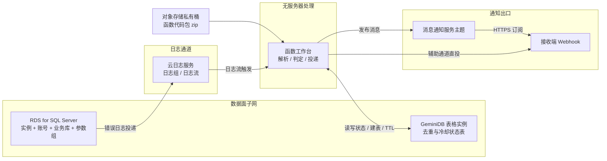

# RDS for SQL Server 错误日志主动监控实践

[](LICENSE)
[](https://www.huaweicloud.com)

## 简介

本实践在华为云上搭建一条「SQL Server 错误日志 → 自动解析判定 → 去重冷却 → 主动通知」的闭环链路，
让数据库错误在被人发现之前就先被通知到值班通道。

传统做法要么靠人定期翻错误日志，要么对每个错误号配一条阈值告警规则：前者滞后，后者在错误高频出现时
会被同一条错误反复刷屏。本实践用无服务器函数取代阈值规则，解决三件具体的事：

1. **采集不留死角**：RDS for SQL Server 的错误日志通过日志投递能力进入云日志服务，错误日志一旦写入即触达处理侧。
2. **只报真错误**：按错误日志的真实行格式解析出「错误号 + 级别 + 状态」，内置噪音话术（日志滚动、常规校验输出、
   纯提示类信息）整条跳过，避免把例行输出当告警。
3. **重复错误自动收敛**：同一个错误号的历史出现与告警时间落在 GeminiDB 表格实例里，冷却窗口内的重复错误
   直接抑制；状态存储读取失败时反向放行（宁可多报也不静默漏报）。

适用于：

- 在华为云上运行 SQL Server 业务库、需要把错误日志转成主动告警的数据库运维与应用运维人员；
- 希望用少量配置落一条可观测、可复现、可销毁的监控链路，而不想长期维护自建采集服务的团队；
- 需要参考「日志触发 + 表格状态存储 + 双通道通知」这一套无服务器组合的工程写法的使用者。

## 目录

- [目录结构](#目录结构)
- [架构图](#架构图)
- [方案亮点](#方案亮点)
- [涉及云服务](#涉及云服务)
- [前置条件](#前置条件)
- [快速开始](#快速开始)
- [分步部署](#分步部署)
- [参数表](#参数表)
- [使用方法与验证](#使用方法与验证)
- [清理资源](#清理资源)
- [详细说明](#详细说明)
- [故障排除](#故障排除)
- [许可证](#许可证)
- [联系方式](#联系方式)

## 目录结构

```text
.
├── docs/
│   ├── architecture.md              数据流、状态表结构与判定语义、设计取舍
│   └── deployment-guide.md          分步部署命令与每步预期输出
├── infra/
│   ├── versions.tf                  Terraform 与 Provider 版本约束
│   ├── providers.tf                 Provider 配置
│   ├── variables.tf                 部署参数与校验
│   ├── locals.tf                    统一命名与标签
│   ├── network.tf                   VPC、子网、安全组
│   ├── rds.tf                       SQL Server 实例、账号、业务库、参数组
│   ├── lts.tf                       日志组、日志流、错误日志投递
│   ├── monitoring.tf                GeminiDB 状态存储、SMN 主题与订阅
│   ├── functions.tf                 代码包桶、函数、日志流触发器
│   ├── iam.tf                       函数运行身份（委托）
│   ├── outputs.tf                   对外输出
│   └── terraform.tfvars.example     参数样例（占位符）
├── src/
│   └── functions/
│       ├── index.py                 函数入口与逐条判定编排
│       ├── config.py                运行配置读取与校验
│       ├── lts_event.py             投递事件解包
│       ├── error_rules.py           解析规则与噪音话术
│       ├── state_store.py           状态表建表、读写与冷却判定
│       ├── notifier.py              SMN 与 Webhook 双通道投递
│       ├── net.py / signing.py      传输、重试与请求签名
│       ├── credentials.py           运行期临时凭据读取
│       ├── logger.py / errors.py    结构化日志与异常分层
│       ├── build_packages.py        代码包构建与自检
│       ├── build/                   构建产物目录（执行构建脚本后生成代码包）
│       └── tests/                   单元测试
├── .gitignore
├── README.md
├── README.en.md
└── LICENSE
```

## 架构图



数据流分五段，逐段对应仓库里的实现：

| 段落 | 实现位置 | 做了什么 |
|-|-|-|
| 错误日志采集 | `infra/lts.tf`（`huaweicloud_rds_lts_log`，`log_type = "error_log"`） | 把实例错误日志投递到本栈自建的日志组与日志流 |
| 解析与规则判定 | `src/functions/lts_event.py`、`src/functions/error_rules.py` | 解包投递事件，按两种错误行形态解析，噪音整条跳过 |
| 去重与冷却状态存储 | `src/functions/state_store.py`、`infra/monitoring.tf` | 首启自动建表，按错误号查询历史，判定首次出现 / 冷却已过 / 窗口内抑制 |
| 通知投递 | `src/functions/notifier.py`、`infra/monitoring.tf` | 主通道向 SMN 主题发布消息，辅助通道直投 Webhook，至少一条成功才算送达 |
| 观测 | `src/functions/logger.py`、`infra/functions.tf` 的日志配置 | 一行一条 JSON 的运行日志，敏感字段落日志前脱敏 |

## 方案亮点

- **事件驱动，无常驻进程**：以日志流作为函数触发源，错误日志到达才执行，不需要自建轮询采集服务。
- **判定口径可核对**：解析规则、噪音话术、冷却与存活时长全部以显式常量与参数写死在代码里，
  改动任何一条都会明确改变告警范围，便于按自己的日志形态收敛。
- **多行错误不丢**：错误头行与描述续行分两次到达时，头行先落状态表并标记未完成，续行补齐描述后再一起判定，
  避免只看到半条错误。
- **去重与冷却有持久化依据**：每次出现写一行状态记录，告警时间回写同一行，冷却判定读的是真实历史而非内存计数；
  记录带存活时长，过期记录不再参与判定。
- **失败如实上报**：事件结构不可识别或运行配置缺项会让本次调用明确失败；单条日志的存储或通知失败只记录明细，
  不打断同批其它日志。
- **通知送达才更新冷却**：两条通道都未送达时不写冷却标记，下一条同类日志仍会重试，避免消息静默丢失。
- **凭据面收敛**：代码包桶为私有且阻断匿名访问，函数以委托身份取包；数据库密码、状态存储口令、通知地址
  全部由使用者在部署参数里填写，输出项里的主题 URN 也标记为敏感。
- **离线可验证**：构建脚本与单元测试不依赖网络，部署前即可完成功能自测与代码包自检。

## 涉及云服务

| 服务 | 在本实践中的作用 | 对应资源 |
|-|-|-|
| 云数据库 RDS for SQL Server | 被监控的数据库实例、高权限账号、业务库、错误日志详细度参数 | `huaweicloud_rds_instance`、`huaweicloud_rds_sqlserver_account`、`huaweicloud_rds_sqlserver_database`、`huaweicloud_rds_parametergroup` |
| 云日志服务 LTS | 承接错误日志的日志组与日志流、错误日志投递通道、函数运行日志落库 | `huaweicloud_lts_group`、`huaweicloud_lts_stream`、`huaweicloud_rds_lts_log` |
| 函数工作台 FunctionGraph | 解析错误日志、去重与冷却判定、通知投递 | `huaweicloud_fgs_function`、`huaweicloud_fgs_trigger`（触发类型 `LTS`） |
| GeminiDB（表格接口） | 错误去重与通知冷却的状态存储 | `huaweicloud_geminidb_instance` |
| 消息通知服务 SMN | 通知汇聚主题与推送到接收端的订阅 | `huaweicloud_smn_topic`、`huaweicloud_smn_subscription` |
| 对象存储服务 OBS | 存放函数代码包的私有桶、匿名访问阻断、只读桶策略与对象上传 | `huaweicloud_obs_bucket`、`huaweicloud_obs_bucket_bpa`、`huaweicloud_obs_bucket_policy`、`huaweicloud_obs_bucket_object` |
| 虚拟私有云 VPC | 承载实例、状态存储与函数的私有网络与子网 | `huaweicloud_vpc`、`huaweicloud_vpc_subnet` |
| 安全组 | 仅放行 VPC 内对数据库端口的访问，不开放公网 | `huaweicloud_networking_secgroup`、`huaweicloud_networking_secgroup_rule` |
| 统一身份认证服务 IAM 委托 | 授予函数运行期访问 LTS、SMN、GeminiDB 的权限 | `huaweicloud_identity_agency`（角色 `LTS CommonSystemAdmin`、`SMN FullAccess`、`GeminiDB FullAccess`） |

## 前置条件

### 账号与权限

- 华为云账号已完成实名认证，所在区域具备 RDS for SQL Server、GeminiDB、LTS、FunctionGraph、OBS、SMN、VPC 的开通与创建权限。
- 使用的账号或委托需具备上述各服务的创建权限，并能在统一身份认证里**创建委托**（本栈要创建信任你账号的委托）。
- 访问密钥：在华为云控制台「服务与支持 → 我的凭证 → 我的访问密钥」页面获取访问密钥 ID 与秘密访问密钥，
  配置到执行 Terraform 的环境里（例如 `HW_ACCESS_KEY`、`HW_SECRET_KEY`、`HW_REGION_NAME`），
  不要把密钥写进代码、`terraform.tfvars` 或提交到仓库。
- 账号名/域名：「我的凭证 → 账号信息」里的账号名即部署参数 `agency_delegated_domain` 的取值，
  用于建立委托信任关系，本手册统一写作 `<HW_ACCOUNT_DOMAIN>`。

### 本实践的两条硬依赖（不满足不可部署）

1. **需要一台真实运行的 Microsoft SQL Server 实例**。本栈通过 `huaweicloud_rds_instance` 创建该实例，
   引擎版本由 `sqlserver_version`（默认 `2022_web`）指定、规格由 `rds_flavor`（默认 `sql.x2.large.4`）指定；
   可售卖的版本与规格、以及 SQL Server 的版本选型与许可口径由使用者自行确认与自备，
   apply 前请在目标区域用控制台或 `huaweicloud_rds_flavors`、`huaweicloud_rds_engine_versions`、
   `huaweicloud_rds_storage_types` 数据源实查，确认默认值在你的区域可用。
2. **GeminiDB 实例的规格码与接口版本需要按目标区域实查后填入**。
   `geminidb_spec_code` 当前默认值 `geminidb.ddm.xlarge.2.arm` 与 `geminidb_version` 默认值 `3.0`
   属于**占位待确认**取值，未实查替换为区域内实际可创建的组合时 **不可 apply**；
   请在 GeminiDB 控制台的创建页或规格接口确认后再写入 `terraform.tfvars`。

### 其它准备

- Terraform `>= 1.5`，huaweicloud Provider `~> 1.70`（约束见 `infra/versions.tf`）。
- Python 3.9 及以上用于跑单元测试；构建脚本 `src/functions/build_packages.py` 的依赖自检使用解释器内置的标准库模块名清单，
  Python 3.10 及以上可完整执行自检，3.9 会打印跳过说明并继续构建。函数运行时的 `fgs_runtime` 为 `Python3.9`。
- 一个可接收 HTTPS POST 的通知接收端地址（本手册写作 `<WEBHOOK_URL>`），用于 SMN 订阅与辅助直投通道。
  该地址必须真实可解析，SMN 订阅资源不接受占位符。
- 数据库与状态存储口令：`<DB_PASSWORD>`、`<GEMINIDB_PASSWORD>` 由使用者自备强口令，
  需满足各自服务的口令复杂度要求。
- 网络前提：本栈不申请公网访问地址，验证链路时要从同一 VPC 内可访问数据库端口（默认 `1433`）的客户端发起连接。
- 区域约束：默认区域 `cn-north-4`，主可用区 `cn-north-4a`、备可用区 `cn-north-4b`；
  改用其它区域时须同步调整 `region`、`az_primary`、`az_standby` 并重新实查上述两条硬依赖的取值。

## 快速开始

以下命令在本仓库根目录执行，`cd infra` 之后的命令均在 `infra/` 目录内执行。

```bash
# 1) 先构建函数代码包（apply 会读取该文件，缺失则报路径不存在）
python src/functions/build_packages.py

# 2) 准备部署参数，替换全部占位符（见下文参数表）
cd infra
copy terraform.tfvars.example terraform.tfvars    # Windows
# cp terraform.tfvars.example terraform.tfvars    # Linux/macOS

# 3) 初始化、静态校验、执行部署
terraform init
terraform validate
terraform apply
```

`terraform validate` 的预期输出为 `Success! The configuration is valid.`。
`terraform apply` 完成后会打印 `rds_instance_id`、`rds_private_ips`、`lts_group_id`、`lts_stream_id`、
`notifier_function_urn`、`geminidb_endpoint`、`geminidb_port`、`notify_topic_urn` 八个输出项，
按 [使用方法与验证](#使用方法与验证) 逐条核对。

## 分步部署

完整分步说明（含每一步预期输出与规格实查方法）见 [docs/deployment-guide.md](docs/deployment-guide.md)，
概览如下：

| 步骤 | 动作 | 关键命令或文件 | 预期结果 |
|-|-|-|-|
| 1 | 建立网络、数据库、状态存储、日志通道、函数与通知通道的基础设施 | `terraform init` / `terraform validate` / `terraform apply` | 输出八个资源标识，实例状态可用 |
| 2 | 构建并上传函数代码包 | `python src/functions/build_packages.py` | 打印包路径、字节数与校验和，包由 OBS 对象资源上传 |
| 3 | 建库、建高权限账号、绑定参数组 | `infra/rds.tf` 中的账号/库/参数组资源 | `db_admin`、`monitordb`、参数组 `error_verbosity = 0` 就绪 |
| 4 | 打开错误日志投递 | `huaweicloud_rds_lts_log`（`log_type = "error_log"`） | 日志流可检索到实例错误日志行 |
| 5 | 验证通知链路 | 制造一条错误日志 → 查函数调用返回 → 查收通知 | 首次 `notified = 1`，重复且冷却窗口内 `suppressed = 1` |
| 6 | 释放资源 | `terraform destroy` | 资源清空，无残留 |

### 函数运行配置项

函数的运行配置由 `infra/functions.tf` 的 `user_data` 下发，键名与 `src/functions/config.py` 逐字一致，共十项：

| 键 | 取值来源 | 说明 |
|-|-|-|
| `NOTIFY_WEBHOOK_URL` | `var.notify_webhook_url` | 接收端地址，仍为 `<WEBHOOK_URL>` 时辅助通道按「未配置」跳过 |
| `STATE_COLLECTION` | `var.geminidb_error_table` | 状态表名，函数首启自动建表 |
| `GEMINIDB_ENDPOINT` | GeminiDB 实例的内网地址 | 状态存储接入地址 |
| `GEMINIDB_PORT` | GeminiDB 实例端口 | 未下发时函数侧默认 `7001` |
| `GEMINIDB_USER` | 固定 `root` | 状态存储账号 |
| `GEMINIDB_PASSWORD` | `var.geminidb_password` | 状态存储口令 |
| `SMN_TOPIC_URN` | SMN 主题 URN | 主通道发布目标 |
| `PROJECT_ID` | 当前账号在本区域的项目编号 | 由本栈下发，函数也可从运行上下文取到同一个值 |
| `REGION` | `var.region` | 签名与作用区域 |
| `NOTIFICATION_COOLDOWN_MINUTES` | `var.notification_cooldown_minutes` | 冷却窗口（分钟），函数内按秒使用 |
| `TTL_HOURS` | `var.state_ttl_hours` | 状态记录存活时长（小时） |

两处都取不到项目编号时，SMN 主通道按「项目编号未配置」跳过并记录原因，此时必须保证 Webhook 辅助通道已配置。

## 参数表

变量清单取自 `infra/variables.tf`（共 39 个），与 `infra/terraform.tfvars.example` 逐行对应。
「必填」列指必须由使用者替换或实查后填入的取值。

| 变量 | 类型 | 默认值 | 必填 | 说明 |
|-|-|-|-|-|
| `region` | string | `cn-north-4` | 否 | 部署区域 |
| `name_prefix` | string | `rds-sqlserver-monitor` | 否 | 统一作用于全部可命名资源 |
| `az_primary` | string | `cn-north-4a` | 否 | 主可用区 |
| `az_standby` | string | `cn-north-4b` | 否 | 备可用区，仅 `rds_ha_mode = "ha"` 时用于主备部署 |
| `enterprise_project_id` | string | `0` | 否 | 企业项目 ID，`0` 表示默认企业项目 |
| `vpc_cidr` | string | `10.20.0.0/16` | 否 | VPC 网段 |
| `subnet_cidr` | string | `10.20.1.0/24` | 否 | 子网网段 |
| `subnet_gateway_ip` | string | `10.20.1.1` | 否 | 子网网关地址 |
| `sqlserver_version` | string | `2022_web` | 实查 | SQL Server 版本，须与目标区域可售版本一致 |
| `rds_flavor` | string | `sql.x2.large.4` | 实查 | RDS for SQL Server 实例规格 |
| `rds_volume_type` | string | `ESSD` | 实查 | 存储类型，取值 `ESSD` 或 `CLOUDSSD` |
| `rds_volume_size` | number | `40` | 否 | 存储容量，单位 GB |
| `rds_ha_mode` | string | `single` | 否 | 高可用模式，校验块限定取值 `single` 或 `ha`，其它取值直接报错 |
| `db_port` | number | `1433` | 否 | 数据库端口，安全组按该端口放行 VPC 内访问 |
| `db_user_name` | string | `db_admin` | 否 | 高权限账号名 |
| `db_password` | string（敏感） | `<DB_PASSWORD>` | **是** | 高权限账号口令，请自备强口令 |
| `app_db_name` | string | `monitordb` | 否 | 业务数据库名 |
| `backup_keep_days` | number | `7` | 否 | 自动备份保留天数，RDS 与 GeminiDB 的备份策略共用该取值 |
| `param_group_name` | string | `rds-sqlserver-monitor-params` | 否 | 参数组名称 |
| `param_group_values` | map(string) | `{ error_verbosity = "0" }` | 否 | 参数组自定义键值；运行期回写已被让权 |
| `geminidb_mode` | string | `Cluster` | 否 | GeminiDB 实例模式 |
| `geminidb_version` | string | `3.0` | **实查** | 接口版本，占位待确认 |
| `geminidb_spec_code` | string | `geminidb.ddm.xlarge.2.arm` | **实查** | 节点规格码，占位待确认，未替换不可 apply |
| `geminidb_node_num` | number | `3` | 否 | 节点数，集群形态最少 3 个节点 |
| `geminidb_node_size` | number | `100` | 否 | 单节点存储，单位 GB |
| `geminidb_password` | string（敏感） | `<GEMINIDB_PASSWORD>` | **是** | GeminiDB `root` 账号口令，同时作为函数运行配置里的状态存储口令 |
| `geminidb_error_table` | string | `SqlServerErrorState` | 否 | 状态表名，函数首启自动建表 |
| `lts_group_ttl_days` | number | `30` | 否 | 日志组留存天数初始值 |
| `lts_stream_ttl_days` | number | `30` | 否 | 日志流留存天数初始值 |
| `fgs_runtime` | string | `Python3.9` | 否 | 函数运行时 |
| `fgs_handler` | string | `index.handler` | 否 | 入口，要求代码包根目录存在 `index.py` 且定义顶层 `handler` 函数 |
| `fgs_memory_size` | number | `256` | 否 | 函数内存，单位 MB |
| `fgs_timeout` | number | `300` | 否 | 函数超时，单位秒 |
| `notifier_package` | string | `../src/functions/build/sqlserver-error-notifier.zip` | 否 | 代码包本地路径，必须与构建脚本产物路径逐字一致 |
| `notify_topic_name` | string | `sqlserver-error-notify` | 否 | SMN 主题名称 |
| `notify_webhook_url` | string（敏感） | `<WEBHOOK_URL>` | **是** | 接收端地址，SMN 订阅端点与函数辅助通道共用；占位符会导致订阅创建失败 |
| `notification_cooldown_minutes` | number | `15` | 否 | 同一错误的通知冷却窗口（分钟） |
| `state_ttl_hours` | number | `10` | 否 | 状态记录存活时长（小时） |
| `agency_delegated_domain` | string | `<HW_ACCOUNT_DOMAIN>` | **是** | 委托信任的账号名，取自「我的凭证 → 账号信息」 |

四个占位符（`<DB_PASSWORD>`、`<GEMINIDB_PASSWORD>`、`<WEBHOOK_URL>`、`<HW_ACCOUNT_DOMAIN>`）与两条实查项
（SQL Server 版本与规格、GeminiDB 规格码与接口版本）必须在 apply 前处理完毕；
`infra/variables.tf` 里唯一的校验块限定 `rds_ha_mode` 的取值，其余取值的合法性由服务端在创建资源时校验。

## 使用方法与验证

### 离线验证（部署前即可做，不联网）

```bash
python -m pytest src/functions -q
```

预期输出（末行统计，具体用例数与耗时随环境略有差异）：

```text
..................................................
50 passed in 0.07s
```

覆盖范围：首次错误告警并回写状态、冷却窗口内重复抑制、冷却已过再次告警、噪音整条跳过、
头行与续行配对告警一次、占位符地址安全跳过、双通道均未送达不更新冷却、通道失败如实上报、
状态存储不可用仍放行、对端不支持存活时长时按过期字段过滤、坏事件明确失败、
单条异常不中断整批、剩余时间不足提前收尾、单次处理条数上限截断。

构建与自检：

```bash
python src/functions/build_packages.py
```

预期输出首部：

```text
notifier -> src/functions/build/sqlserver-error-notifier.zip (29105 bytes)
  sha256: cc3d305a8f2da488423c238c55e61961ff1f04e8cb8c6a636d9d30fc49df3421
  - config.py
```

清单里的包路径与 `var.notifier_package` 默认值、`huaweicloud_obs_bucket_object.notifier_code` 的
`source` 完全一致；只想看包内条目可用 `python src/functions/build_packages.py --list`（不写文件）。

### 部署后最简示例

1. **确认资源就绪**：在 apply 输出里取 `rds_private_ips`、`geminidb_endpoint`、`lts_stream_id`、`notifier_function_urn`。
2. **从 VPC 内客户端连接实例**：地址取 `rds_private_ips`，端口取 `db_port`（默认 `1433`），
   账号用 `db_admin` 与你在 `db_password` 里填写的口令。
3. **制造一条可复现的错误日志**（会同时写入实例错误日志，因此会投递到日志流）：

   ```sql
   RAISERROR (N'monitoring smoke test, error logging pipeline', 16, 1) WITH LOG;
   GO
   ```

   该语句在错误日志里形成一条 `Error: <错误号>, Severity: 16, State: 1` 形态的头行，
   描述在紧随其后的日志行里，正好走「头行先记录、续行补齐后判定」这条路径。
   若账号权限不足以写错误日志，请改由具备相应权限的账号执行，或等待业务真实错误进入错误日志。
4. **在日志流里确认采集生效**：用 LTS 控制台检索该日志流，应看到包含
   `Error: `、`Severity: `、`State: ` 的原始行。
5. **查看函数这一次调用的返回结果**，字段与 `src/functions/index.py` 一致：

   ```json
   {
     "statusCode": 200,
     "records": 2,
     "counts": {
       "noise_skipped": 0,
       "notified": 1,
       "suppressed": 0,
       "notification_failed": 0,
       "pending_description": 1,
       "unmatched_text": 0,
       "state_write_failed": 0,
       "error_detected": 1
     },
     "state_store": { "table": "SqlServerErrorState", "enabled": true, "ttl_enabled": true }
   }
   ```

6. **确认去重与冷却生效**：在 `notification_cooldown_minutes`（默认 15 分钟）之内再次执行同一条 `RAISERROR`，
   同错误号 + 同级别 + 同状态的重复出现这一次不计入 `notified`，而是：

   ```json
   "suppressed": 1
   ```

   `actions` 里对应条目的 `reason` 为 `suppressed_within_cooldown`，并带上 `cooldown_seconds`（默认 `900`）。
   超过冷却窗口后再执行，`reason` 变为 `cooldown_expired`，重新告警一次。
7. **确认通知到达**：在 `<WEBHOOK_URL>` 接收端应看到 SMN 主题推送或函数直投的消息，
   正文由 `src/functions/notifier.py` 渲染，含错误号、级别、状态、行号、日志时间、消息、原文、
   日志组、日志流、来源主机、解析规则等字段；Webhook 直投的 JSON 含
   `title`、`text`、`error_number`、`level`、`state`、`log_timestamp`、`message`、`log_group_id`、`log_stream_id`。
8. **确认状态表落库**：在 GeminiDB 实例的 `SqlServerErrorState` 表里按 `error_number` 查询，
   应看到本次出现的记录，`last_notification` 已更新为告警时间，`expiry_time` 为告警时间加
   `state_ttl_hours`（默认 10 小时）。

也可以用函数的测试入口验证同一条链路：下面的命令在仓库根目录执行，它复用仓库内的测试支撑代码，
按真实投递结构（外层 Base64 + 内层 `logs` 字符串）生成一份带当前时间戳的事件 JSON，直接粘贴到
函数测试页运行（每次生成都要用新的时间戳，过期记录不参与冷却判定）：

```bash
python -c "import sys,json;sys.path[:0]=['src/functions','src/functions/tests'];import support;print(json.dumps(support.build_event([{'content':'Error: 50000, Severity: 16, State: 1.'}], log_group_id='lg-demo', log_stream_id='ls-demo'),ensure_ascii=False))"
```

预期输出形如：

```text
{"lts": {"data": "eyJsb2dzIjogIlt7XCJjb250ZW50XCI6IFwiRXJyb3I6IDUwMDAw..."}}
```

> 部署完成后，请按本节步骤在真实环境里自行验证：确认错误日志已进入日志流、函数已被唤起并返回预期计数、
> 冷却窗口内的重复错误被抑制、通知确实到达你的接收端。全部核对通过后，本实践才算在你环境中交付完成。

## 清理资源

在本仓库根目录执行：

```bash
cd infra
terraform destroy
```

预期输出末行为 `Destroy complete! Resources: N destroyed.`。

- 代码包桶设置了 `force_destroy = true`，销毁时会连带清空桶内对象；其它资源逐个释放。
- 委托、SMN 主题与订阅、日志组与日志流、GeminiDB 实例、RDS 实例、安全组与子网、VPC 都在销毁范围内，
  请及时释放资源、避免残留，尤其是你在接收端配置的外部服务关联。
- 本地构建产物 `src/functions/build/sqlserver-error-notifier.zip` 由构建脚本生成，可按需删除，重新构建即可复现。

## 详细说明

- [docs/architecture.md](docs/architecture.md)：数据流细节、状态表结构与判定语义、解析规则与噪音话术、通知渲染、容错与观测设计取舍。
- [docs/deployment-guide.md](docs/deployment-guide.md)：从零到可验证部署的分步命令，每步附预期输出。
- [README.en.md](README.en.md)：本文件的英文版本，结构一致。

## 故障排除

| 现象 | 原因与处理 |
|-|-|
| apply 在 SMN 订阅资源上报错 | `notify_webhook_url` 仍是 `<WEBHOOK_URL>` 占位符，订阅端点必须是可解析的 HTTPS 地址 |
| apply 在 GeminiDB 实例上报规格不可用 | `geminidb_spec_code` 与 `geminidb_version` 未按目标区域实查，属于占位取值 |
| apply 在 RDS 实例上报版本或规格不可选 | `sqlserver_version`、`rds_flavor`、`rds_volume_type` 与区域内实际可售卖组合不一致，先实查再填 |
| apply 在委托上报参数非法 | `agency_delegated_domain` 仍是占位符，请填写「我的凭证」里的账号名 |
| 函数报「运行配置缺少必需项」 | `STATE_COLLECTION`、`GEMINIDB_ENDPOINT`、`GEMINIDB_USER`、`GEMINIDB_PASSWORD` 四项必须有真实值，占位符等同未配置 |
| 通知只有辅助通道到达 | 函数配置与运行上下文都取不到项目编号时，主通道按「项目编号未配置」跳过，属预期保护行为；需要主通道时确认委托与项目权限 |
| 返回结果里 `state_store.enabled` 为 `false` | 状态存储不可用（网络或口令问题），函数按「放行告警」处理，此时可能出现重复告警，需先修复状态存储连通性 |
| 函数被反复唤起且批次里没有错误行 | 函数运行日志单独落在 `<名称前缀>-notifier-runtime` 流，错误日志流只承接实例导出的错误行；若仍出现空批次，先核对两条流的归属是否被运行期改动，`unmatched_text` 计数可用于确认批次内容 |
| 冷却没生效 | 状态表记录已过期（超过 `state_ttl_hours`）或同错误号的级别/状态与历史不同，冷却判定按「错误号 + 级别 + 状态」三者一致计算 |
| 错误日志里没有 `Msg`/`Error:` 形态的行 | 该错误未被写入错误日志，请确认数据库端是否已把消息写入错误日志，并核对 `param_group_values` 的错误日志详细度取值 |

## 许可证

本实践采用 MIT No Attribution 许可证发布，详见 [LICENSE](LICENSE)。

## 联系方式

本实践由公有云持续运营部创建与维护。
