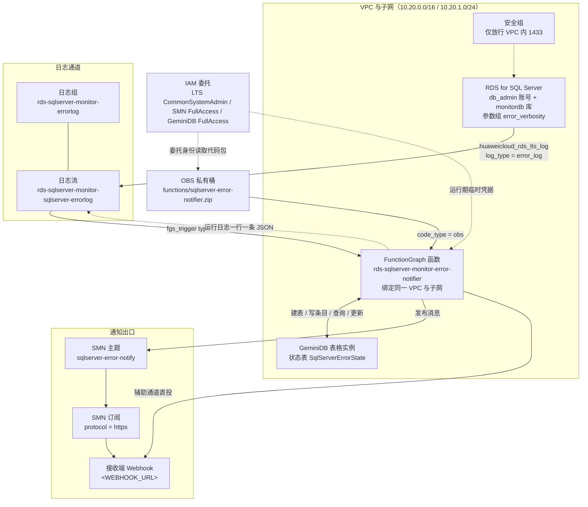

# 架构说明

本文按数据流经的五个阶段说明本实践的实现：错误日志采集 → 函数解析与规则判定 → 去重与冷却状态存储 →
通知投递 → 观测。所有结论均取自 `infra/*.tf` 与 `src/functions/` 的现有实现。

## 1. 总览



组件清单与职责：

| 组件 | 资源 | 职责 |
|-|-|-|
| 被监控数据库 | `huaweicloud_rds_instance.sqlserver`、`huaweicloud_rds_sqlserver_account.admin`、`huaweicloud_rds_sqlserver_database.app`、`huaweicloud_rds_parametergroup.main` | 产生错误日志，并提供账号、业务库与错误日志详细度参数 |
| 日志通道 | `huaweicloud_lts_group.errorlog`、`huaweicloud_lts_stream.sqlserver_errorlog`、`huaweicloud_rds_lts_log.error_log` | 承接错误日志，作为函数触发源 |
| 处理函数 | `huaweicloud_fgs_function.notifier`、`huaweicloud_fgs_trigger.lts` | 解析、判定、投递，绑定 VPC 以便访问状态存储内网地址 |
| 状态存储 | `huaweicloud_geminidb_instance.state` | 持久化错误出现记录与告警时间 |
| 通知通道 | `huaweicloud_smn_topic.notify`、`huaweicloud_smn_subscription.webhook` | 消息汇聚与推送到接收端 |
| 代码分发 | `huaweicloud_obs_bucket.code`、`huaweicloud_obs_bucket_bpa.code`、`huaweicloud_obs_bucket_policy.code_agency`、`huaweicloud_obs_bucket_object.notifier_code` | 私有桶存放函数代码包，仅授予委托只读 |
| 网络 | `huaweicloud_vpc.main`、`huaweicloud_vpc_subnet.main`、`huaweicloud_networking_secgroup.main`、`huaweicloud_networking_secgroup_rule.allow_db_intra_vpc` | 私网承载，数据库端口仅对 VPC 网段放行 |
| 运行身份 | `huaweicloud_identity_agency.fgs` | 让函数以临时凭据访问 LTS、SMN、GeminiDB |

## 2. 阶段一：错误日志采集

- 采集对象是实例内部的错误日志，不是慢查询日志或审计日志。投递由
  `huaweicloud_rds_lts_log.error_log` 声明：`engine = "sqlserver"`、`log_type = "error_log"`，
  目标为本栈自建的日志组与日志流。
- 日志组与两条日志流的留存天数由 `lts_group_ttl_days` / `lts_stream_ttl_days` 给出初始值（默认 30），
  这三个资源的 `ttl_in_days` 字段都做了运行期让权（`ignore_changes = [ttl_in_days]`），
  后续在控制台调整留存天数不会被本次部署口径覆盖。
- 数据库端需要把消息真正写入错误日志，链路才有输入。参数组默认给 `error_verbosity = 0`，
  参数组的 `values` 同样让权给运行期（控制台与内核回写不被覆盖）。
- 触发方式：`huaweicloud_fgs_trigger.lts` 以日志组与日志流为触发源，`type = "LTS"`、
  `status = "ACTIVE"`；触发器状态也让权给运行期，运维可在控制台临时停用而不触发回滚。

设计取舍：**用日志流触发而不是轮询错误或指标阈值**。指标告警只能覆盖有指标的错误，
且需要为每类错误维护阈值；错误日志本身包含错误号、级别、状态与原文，直接把它作为事件源，
既覆盖全量错误，又把判定逻辑放进可版本化的代码里。

## 3. 阶段二：函数解析与规则判定

函数入口是 `index.handler`（`var.fgs_handler` 默认值），代码包根目录为 `index.py`，
入口必须是名为 `handler` 的顶层函数，这一点由构建脚本 `build_packages.py` 在打包前静态校验。

### 3.1 事件解包

`lts_event.unpack()` 处理的是日志服务投递事件形态：

```json
{
  "lts": {
    "data": "<Base64 编码的 JSON 字符串>"
  }
}
```

Base64 解出的内层对象含 `logs`（可能是日志条目数组的字符串形态）、`owner`、`log_group_id`、`log_topic_id`。
单条日志条目取的字段有优先级候选：原文取 `content`/`message`/`log`/`text`，
毫秒时间戳取 `time`/`btime`/`gtimestamp`/`timestamp`/`log_time`（秒级会自动补齐为毫秒），
主机名取 `host_name`/`hostname`/`host`，另有 `ip`、`path`、`log_uid`、`line_no`。

宽松解包的边界：

- 外层还兼容 `{"data": "<base64>"}` 与「投递对象直接作为事件体」两种形态；
- 条目是字符串时先尝试按 JSON 对象解析，仍不是对象就退化为「一行原文」；
- 单条结构异常只跳过并计数（`skipped_records`），不影响同批其它条目；
- 整份事件都不是可识别结构时抛 `EventFormatError`，让本次调用明确失败。

### 3.2 解析规则

`error_rules.parse_error()` 只认两种错误行形态：

| 形态 | 行样式 | 解析结果 |
|-|-|-|
| A（完整行，同行带描述） | `Msg <错误号>, Level <级别>, State <状态>, Server <实例>, Line <行号> <描述>` | `rule = msg_level_state_server_line`，`is_complete = True` |
| B（头行 + 续行） | `Error: <错误号>, Severity: <级别>, State: <状态>` | `rule = error_severity_state`，`is_complete = False`，描述留空等待补齐 |

时间戳从行内按 `2026-10-15 10:00:00.123` 样式提取，仅作为告警正文里的「日志时间」，不参与主键。

噪音判定在解析之前执行，命中即整条跳过（既不写状态表也不告警）。噪音话术共 11 条，
整行不区分大小写匹配：日志滚动尝试、错误日志文件写入声明、校验结果为 0 错误 0 修复、
纯提示类信息、错误日志重新初始化、重复计数时间阈值提示、DBCC 执行完成提示、DBCC 标准输出与标准错误前缀、
DBCC 额外输入、DBCC 无正在处理的命令。

判定口径的关键取舍：**只看能否解析出「错误号 + 级别 + 状态」，不设级别阈值**。
凡能解析且不属于噪音的错误都进入告警判定，重复抑制完全交给状态表的冷却窗口。
这样新增错误类型无需改代码，代价是低级别错误也会进入一次告警。

### 3.3 单条日志的处理分支

`index.process()` 对每条日志产出下列动作之一，计数写入返回结果的 `counts`：

| 动作 | 触发条件 |
|-|-|
| `noise_skipped` | 命中噪音话术 |
| `pending_description` | 形态 B 头行已落状态表，等待续行补齐描述，本条不发通知 |
| `notified` | 判定放行且至少一条通知通道送达 |
| `suppressed` | 判定被冷却窗口拦下 |
| `notification_failed` | 判定放行但两条通道都未送达 |
| `unmatched_text` | 既解析不出错误结构，也没有等待补齐的历史记录 |
| `state_write_failed` | 状态存储写入失败（同批继续处理，失败明细进 `errors`） |

未命中解析规则的行会走「补齐描述」路径：先查最近一条未完成记录，把该行去掉时间戳与 `spid` 前缀后
作为描述写入，再按合并后的记录重新判定是否告警。

### 3.4 时间与批量边界

- 单次调用的时间预算取函数上下文的剩余执行时间，取不到时按 300 秒兜底；
  剩余时间低于 5 秒停止处理新条目，返回结果里记 `deadline_exhausted` 与 `unprocessed_records`。
- 单次最多处理 200 条日志（`max_records_per_invoke`），超出部分记 `truncated_to_max_records_per_invoke`，
  留待下一批日志触发时处理。
- 单次外部调用 10 秒超时、最多 3 次尝试、退避 0.5 秒；只对可恢复失败重试
  （对端返回 408/429/500/502/503/504 视为可恢复）。
- 返回结果里 `actions` 最多保留 50 条明细。

## 4. 阶段三：去重与冷却状态存储

### 4.1 表结构

状态存储是 GeminiDB 的表格接口实例（`datastore.type = "DynamoDB"`，存储引擎 `rocksdb`）。
函数首启通过 `DescribeTable`/`CreateTable`/`UpdateTimeToLive` 幂等地把表建好，表名取 `STATE_COLLECTION`
（即 `var.geminidb_error_table`，默认 `SqlServerErrorState`）。

| 字段 | 类型 | 作用 |
|-|-|-|
| `error_number` | 数字 | 分区键，错误号 |
| `timestamp` | 数字 | 排序键，日志条目的毫秒时间戳，与错误号共同构成主键 |
| `level` / `state` / `line` | 数字 | 级别、状态、行号，参与冷却判定与告警正文 |
| `message` / `full_message` / `log_timestamp` | 文本 | 描述、原文、行内时间戳 |
| `is_complete` | 布尔 | 形态 B 头行是否为 false，等待续行补齐 |
| `rule` | 文本 | 命中的解析规则名 |
| `log_group_id` / `log_stream_id` / `host` / `ip` / `path` | 文本 | 来源标识 |
| `occurred_at` / `record_created_at` / `utc_time` | 数字与文本 | 出现时间、写入时间、写入的 UTC 时间 |
| `expiry_time` | 数字 | 存活到期时间（Unix 秒），TTL 属性 |
| `last_notification` | 数字 | 最近一次告警时间（Unix 秒），0 表示从未告警 |
| `notification_sent` | 布尔 | 是否已发出过告警 |

每次出现都写成一行（主键含出现时间），因此「同一个错误的历史」是同一分区键下的一批行。

### 4.2 判定语义

`StateStore.decide(error_number, level, state)` 返回 `(是否告警, 原因, 最近一次告警时间)`：

```text
状态存储不可用            -> (True,  "state_store_unavailable", 0)
查询失败                  -> (True,  "state_store_query_failed", 0)
无历史记录                -> (True,  "first_occurrence", latest)
now - last_notification > 冷却秒数 -> (True,  "cooldown_expired", latest)
其余                      -> (False, "suppressed_within_cooldown", latest)
```

要点：

- 查询按 `error_number` 取分区，再用 `level` 与 `state` 过滤，冷却窗口只在「错误号 + 级别 + 状态」三者一致时生效；
- 过期记录（`expiry_time <= now`）在返回前被剔除，不参与冷却判定；
- 对端接受 TTL 时由服务端清理（返回结果 `state_store.ttl_enabled = true`）；
  对端不接受 TTL 接口时退化为上面的过期字段过滤，函数会记一条「改按 `expiry_time` 过滤」的告警日志；
- 首次出现放行、查询失败也放行，方向是「宁可多报也不漏报」；
- 通知未送达时不写冷却标记：`index._notify_if_allowed()` 只在返回 `delivered` 为真时调用
  `mark_notified()`，否则下一条同类日志仍会重试；
- 主键覆盖时保留历史 `last_notification`，避免同一条记录被重写导致冷却窗口被无谓重置。

`mark_notified()` 同时把 `expiry_time` 顺延为「告警时间 + `TTL_HOURS`」，让仍在被关注的错误不至于
因到期而丢失冷却依据。

### 4.3 连通与鉴权

- 函数的 `vpc_id` / `network_id` 指向本栈子网，`GEMINIDB_ENDPOINT` 下发的是实例内网地址，
  因此状态存储不出公网；函数侧按 `https://<地址>:<端口>` 组装接入点，对端证书不做校验（内网自签场景）。
- 状态存储的调用凭据用 `GEMINIDB_USER`（固定 `root`）与 `GEMINIDB_PASSWORD` 签署；
  若这对账号口令不可用，函数退回使用运行上下文的临时凭据并记录一条告警日志。
- GeminiDB 实例规格、备份策略与节点数在 `monitoring.tf` 里显式声明，并对 `flavor`、`backup_strategy`
  做运行期让权。

## 5. 阶段四：通知投递

`Notifier.send()` 一次调用同时尝试两条通道，逐通道结果写入返回结果的 `channels`：

| 通道 | 实现 | 取值来源 | 跳过条件 |
|-|-|-|-|
| 主通道 SMN | 向主题发布消息（`subject` 截断到 250 字符），由主题订阅推送给接收端 | `SMN_TOPIC_URN`、运行上下文的项目编号、上下文临时凭据 | 主题 URN 未配置、项目编号未配置、运行凭据不可用 |
| 辅助通道 Webhook | 直接 POST 一段 JSON 到接收端 | `NOTIFY_WEBHOOK_URL` | 地址为空或仍是 `<WEBHOOK_URL>` 占位符 |

主题侧还配套声明了 `huaweicloud_smn_subscription.webhook`（`protocol = "https"`，
`endpoint = var.notify_webhook_url`），因此即使函数直投失败，主题仍会把消息推给同一接收端。

判定「送达」的口径是：任一通道状态以 `sent` 开头。两条都失败时记 `notification_failed` 计数、
输出「所有通知通道均未送达」的错误日志，并且不更新冷却标记。

告警正文由 `notifier.build_message()` 渲染，标题为 `SQL Server 错误告警：<错误号>`，
正文逐行列出错误号、级别、状态、行号、日志时间、消息、原文、日志组、日志流、来源主机、解析规则。
Webhook 直投的 JSON 字段为 `text`、`title`、`error_number`、`level`、`state`、`log_timestamp`、
`message`、`log_group_id`、`log_stream_id`。

## 6. 阶段五：观测

- **运行日志**：`logger.StructuredLogger` 每行输出一个 JSON 对象，公共字段是 `level`、`time`、
  `request_id`、`function_name`、`message`，其余为调用处传入的结构化字段。
- **脱敏**：字段名命中 `password`、`secret`、`access_key`、`accesskey`、`security_token`、`token`、
  `webhook`、`credential`、`authorization` 之一时值替换为 `<masked>`；长文本按 800 字符截断，
  因此通知地址的查询参数与口令不会落到日志里。
- **关键节点日志**：开始处理（带区域、表名、状态存储地址、是否取到运行凭据与配置视图）、
  事件解包完成（条目数与跳过数）、状态表就绪、忽略噪音日志、错误头行已记录、
  冷却窗口内重复错误抑制通知、已发布到消息通知主题、已发送 Webhook 通知、
  所有通知通道均未送达、日志事件处理完成（汇总计数与耗时）。
- **返回结果**：`statusCode`、`log_group_id`、`log_stream_id`、`records`、`skipped_records`、
  `actions`、`warnings`、`errors`、`counts`、`state_store`（表名、是否可用、TTL 是否由对端托管）、
  `duration_seconds`；失败明细带条目序号与所处阶段（`state_store`、`record`、`record_occurrence`、
  `latest_incomplete`、`attach_description`、`mark_notified`）。
- **函数自身日志分溪流**：SQL Server 错误日志流（`<名称前缀>-sqlserver-errorlog`）只作为解析与通知的触发源；
  函数自身的运行日志写入独立的 `<名称前缀>-notifier-runtime` 流。两条流分开是必要的——若把运行日志写进触发源
  所在的那条流，函数每次调用产生的日志会再次成为投递事件并形成新一轮调用，批次里解析不出错误结构，
  表现为 `unmatched_text` 计数。
- **平台侧可观测**：事件结构不可识别与运行配置缺项会让本次调用失败，在函数运行记录里可直接看到失败与原因；
  本栈未声明指标告警规则，指标侧告警请在使用者自己的监控体系里补齐。

## 7. 安全设计

- 代码包桶 `acl = "private"`，`huaweicloud_obs_bucket_bpa` 四项全开阻断匿名访问与公开策略；
  桶策略只给委托授予 `GetObject` 与 `ListBucket`，不开放公开读。
- 函数取包走对象存储数据面的委托身份，代码里不出现长期密钥；运行期凭据只从调用上下文取，
  且输出时统一走 `redacted()` 脱敏。
- 安全组只有一条入方向规则：VPC 网段到 `var.db_port` 的 TCP，未创建任何公网访问地址。
- 数据库口令、状态存储口令与通知地址在变量里标记为敏感且默认值只是占位符；
  `notify_topic_urn` 输出也标记为敏感。
- 所有可命名资源带 `ManagedBy` / `Environment` / `Purpose` 标签，便于按标签清点与隔离。

## 8. 关键设计取舍汇总

| 取舍 | 选择 | 代价 |
|-|-|-|
| 触发方式 | 日志流触发，无轮询 | 依赖错误日志投递通道可用，投递延迟直接体现在告警延迟上 |
| 告警阈值 | 不设级别阈值，解析出错误即判定 | 低级别错误也会收到一次通知 |
| 去重实现 | 状态表持久化，按错误号 + 级别 + 状态冷却 | 需要一台 GeminiDB 实例，且实例规格需按区域实查 |
| 状态存储不可用时 | 放行告警 | 极端情况下出现重复通知 |
| 通知通道 | 双通道，任一成功即算送达 | 只配置一条通道时另一条会留跳过原因 |
| 冷却写回时机 | 送达后才写回 | 通道持续失败时同类错误会反复重试告警 |
| 运行日志与错误日志分溪流 | 同一日志组内两条流，触发源只订阅错误日志流 | 运行日志不再回环触发函数自身 |
